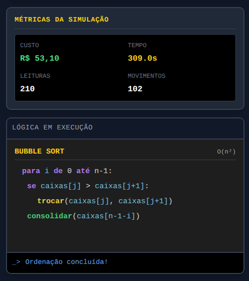
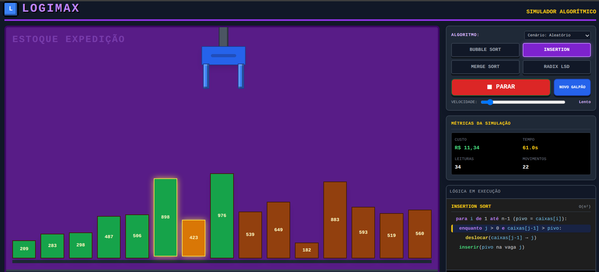
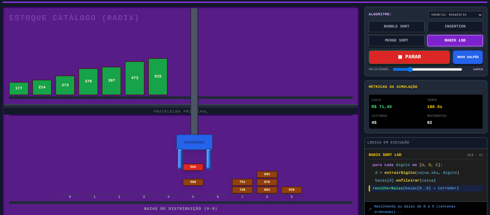
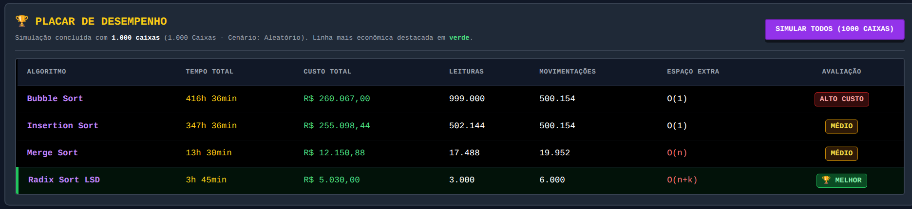

# 📦 LOGIMAX: Simulador de Algoritmos de Ordenação
> **Trabalho 2 — Estrutura de Dados 2 (EDA2 - 2026.2)**  
> Um simulador visual e interativo que coloca algoritmos clássicos de ordenação para organizar o estoque de um centro de distribuição automatizado!

🔗 **Experimente agora no navegador:** [Acessar Simulador LOGIMAX](https://eda2-2026.github.io/G15_Ordenacao_EDA2-2026.2/)

---

## 🎥 Vídeo de Apresentação

 **Link do vídeo:** [Video da Apresentação](https://youtu.be/Og0SDgjBhdY).

---

## 🎯 O Cenário: O Caos na LogiMax

A **LogiMax Distribuição** recebe centenas de caixas diariamente e as armazena no primeiro espaço vago. O resultado? Um estoque desordenado onde robôs demoram até **40 minutos** para encontrar um único produto! 

Para resolver o gargalo, a empresa precisa ordenar as caixas pelo código **SKU** numérico. Nossa missão é testar e comparar os algoritmos na prática para responder: **qual algoritmo entrega o menor tempo e o menor custo operacional para cada setor do galpão?**

---

## 🤖 Da Computação ao Chão de Fábrica

Para tornar o estudo intuitivo, cada conceito de ordenação foi mapeado para a rotina do armazém:

| Conceito Teórico | Representação no Galpão |
| :--- | :--- |
| **Elemento do vetor** | 📦 Caixa física identificada pelo código SKU numérico |
| **Comparação de chaves** | 🔍 Leitor de código de barras escaneando as caixas |
| **Troca / Deslocamento** | 🦾 Garra robótica movendo caixas pela esteira |
| **Memória Auxiliar (O(n))** | 🏗️ Área de transbordo no chão do galpão |
| **Filas / Buckets** | 🏷️ Baias de separação rápida (0 a 9) |
| **Estabilidade** | 🛡️ Caixas com mesmo SKU não trocam de lugar à toa |

---

## ⚡ Algoritmos em Ação

Testamos quatro abordagens para diferentes necessidades do armazém:

* 📦 **Bubble Sort (Ponto de Partida):**
  * *Como opera:* Compara caixas vizinhas e troca quando fora de ordem.
  * *No galpão:* Representa o sistema antigo. Simples, mas ineficiente para grandes volumes.

* 📥 **Insertion Sort (Expedição):**
  * *Como opera:* Pega uma nova caixa e encaixa diretamente na vaga correta entre as já ordenadas.
  * *No galpão:* Excelente para prateleiras **quase ordenadas** que recebem poucos itens novos ($O(n)$ no melhor caso). Não consome espaço extra!

* 🔄 **Merge Sort (Estoque Geral):**
  * *Como opera:* Divide o lote pela metade, ordena as partes e faz a intercalação estável.
  * *No galpão:* Ideal para grandes lotes bagunçados. Mantém tempo previsível de $O(n \log n)$, mas exige **área de transbordo** no chão.

* 🏷️ **Radix Sort LSD (Catálogo por Dígitos):**
  * *Como opera:* Não compara caixas entre si! Distribui em 10 baias dígito a dígito (unidades, dezenas e centenas) em ordem FIFO.
  * *No galpão:* Extremamente rápido para SKUs numéricos de tamanho fixo, com custo linear $O(d \cdot n)$.

---

## 🛡️ Por que a Estabilidade é Fundamental?

> 💡 **Regra de Ouro da LogiMax:**  
> Se duas caixas possuem o mesmo SKU, trocá-las de lugar gasta bateria do robô, tempo de esteira e manutenção sem gerar ganho algum.  
> Por isso, **todos os algoritmos implementados são estáveis** — garantindo que caixas com códigos iguais nunca se desloquem inutilmente.

---

## 💰 Modelo de Tempo e Custo

O simulador calcula o impacto financeiro e operacional de cada rodada com base em:

$$\text{Custo} = (\text{leituras} \times R\$\,0{,}01) + (\text{movimentações} \times R\$\,0{,}50) + (\text{área extra} \times R\$\,2{,}00)$$

$$\text{Tempo} = (\text{leituras} \times 0{,}5\text{s}) + (\text{movimentações} \times 2{,}0\text{s})$$

---

## 📊 Quadro de Complexidade

| Algoritmo | Melhor Caso | Caso Médio | Pior Caso | Espaço Extra | Estável? |
| :--- | :---: | :---: | :---: | :---: | :---: |
| **Bubble Sort** | $O(n)$ | $O(n^2)$ | $O(n^2)$ | $O(1)$ | Sim |
| **Insertion Sort** | $O(n)$ | $O(n^2)$ | $O(n^2)$ | $O(1)$ | Sim |
| **Merge Sort** | $O(n \log n)$ | $O(n \log n)$ | $O(n \log n)$ | $O(n)$ | Sim |
| **Radix Sort LSD** | $O(d \cdot (n+k))$ | $O(d \cdot (n+k))$ | $O(d \cdot (n+k))$ | $O(n+k)$ | Sim |

---

## 🚀 Como Usar o Simulador

1. **Escolha o Algoritmo e Cenário:** Selecione entre *Aleatório*, *Quase Ordenado* ou *Inverso*.
2. **Controle a Execução:** Clique em **▶ INICIAR** e regule a velocidade (do modo didático lento ao **⚡ Turbo**).
3. **Acompanhe ao Vivo:** Observe o robô movimentando caixas, o pseudocódigo iluminando cada passo e as métricas atualizando em tempo real.
4. **Compare no Placar:** Use o botão **SIMULAR TODOS (1000 CAIXAS)** para rodar uma simulação em lote e ver qual algoritmo é coroado como o mais econômico! 🏆

---

## 💻 Como Rodar Localmente

Por ser uma aplicação web pura (HTML5, Tailwind CSS e Vanilla JavaScript), não é necessária nenhuma instalação ou configuração:

```bash
# Clone o repositório
git clone https://github.com/eda2-2026/G15_Ordenacao_EDA2-2026.2.git

# Acesse a pasta
cd G15_Ordenacao_EDA2-2026.2

# Recomendação é instalação da extensão live server executando pela extensão. 
```
Outra opção é abrindo o index.html pela pasta raiz
---

## 📁 Estrutura do Projeto

```
G15_Ordenacao_EDA2-2026.2/
├── README.md                   # Documentação completa
├── index.html                  # Interface gráfica (HTML5/Tailwind)
├── docs/
│   └── img/                    # Capturas de tela do simulador
└── src/                        # Código-fonte modular
    ├── app.js                  # Controle central, animação e estado
    ├── calculo.js              # Modelo de métricas de custo e tempo
    ├── bubblesort.js           # Algoritmo Bubble Sort
    ├── insertion.js            # Algoritmo Insertion Sort
    ├── mergesort.js            # Algoritmo Merge Sort
    └── radixlsd.js             # Algoritmo Radix Sort LSD
```

## Prints da interface

<table>
  <tr>
    <td rowspan="2" align="center" valign="middle">
      <b>Bubble Sort (Painel e Lógica)</b><br><br>
      
    </td>
    <td align="center" valign="middle">
      <b>Insertion Sort</b><br>
      
    </td>
  </tr>
  <tr>
    <td align="center" valign="middle">
      <b>Radix Sort LSD (10 Baias)</b><br>
      
    </td>
  </tr>
</table>

| Placar de Desempenho (1.000 caixas) |
| :---: |
|  |


## Equipe

<div align="center">

| [](https://github.com/eduarda-ogomes)<br><nobr><sub style="font-size: 160%;">Maria Eduarda de Oliveira</sub></nobr> | [](https://github.com/pwdrinho)<br><nobr><sub style="font-size: 160%;">Pedro Lucas Barbosa</sub></nobr> |
| :---: | :---: |
| 242028842 | 241025710 |

</div>

---
